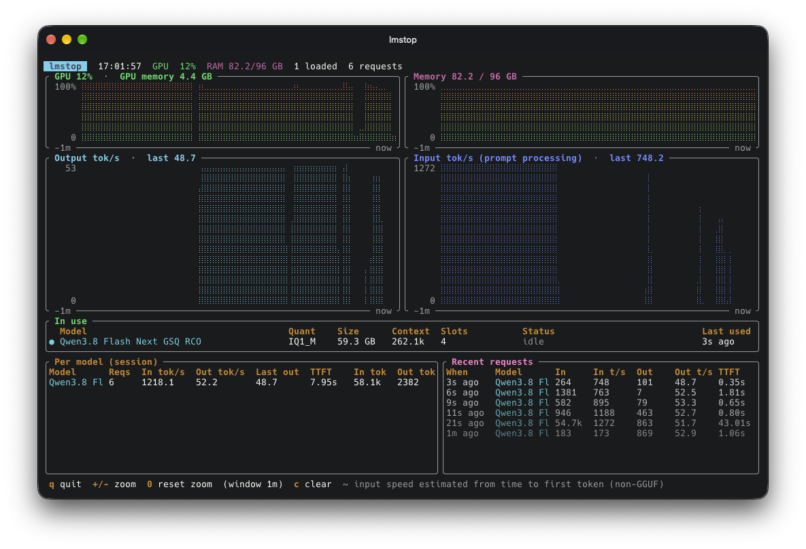

# lmstop

btop-style terminal monitor for [LM Studio](https://lmstudio.ai) on macOS.



- Input and output tok/s, live while generating (GGUF models)
- GPU and memory usage
- Loaded models, per-model stats and recent requests

## Install

```sh
cargo install --git https://github.com/will-tm/lmstop
```

Needs LM Studio's `lms` CLI (`~/.lmstudio/bin/lms`).

Keys: `+`/`-` zoom, `0` reset zoom, `c` clear, `q` quit.
